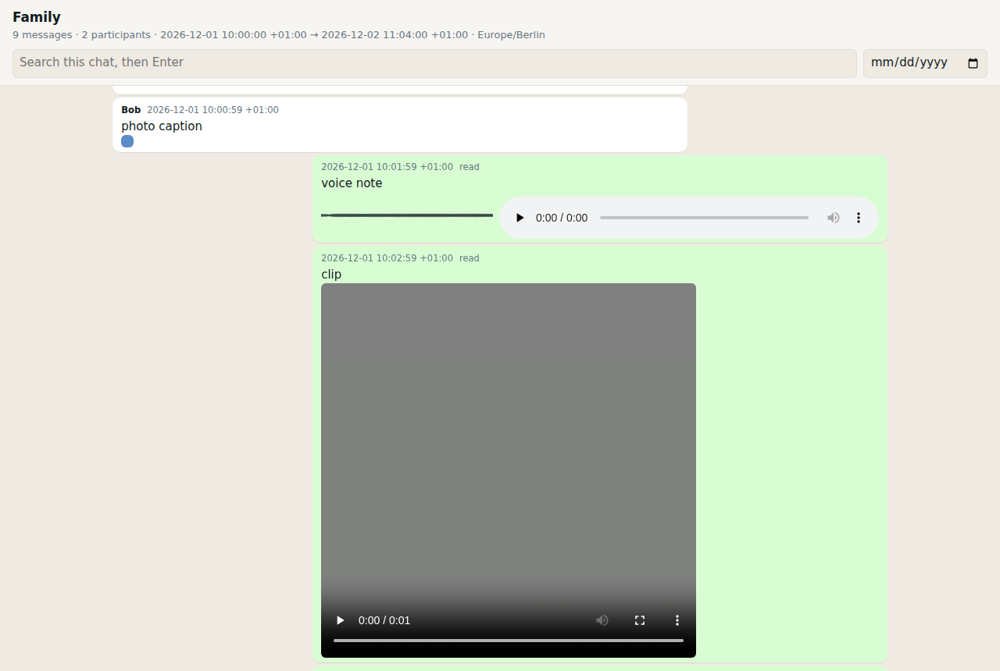

# wexport

Turn an Android WhatsApp backup into a local, scrollable archive of your chats — every message, every
image, video and voice note, with each timestamp frozen at build time so the archive still says when
something happened in ten years.

Each chat becomes one folder that opens by double-clicking `index.html`: no server, no wexport, no
network. Give someone one folder and they see one conversation and nothing else.

**WhatsApp's own *Export chat* is built for forwarding a conversation, not for keeping one.** It
exports a single chat at a time, as a plain-text file with the media flattened beside it — and on the
long conversations people actually want to keep, its text comes out tangled. That is the problem
wexport was written for, and it is why it goes after the backup instead of the export:

- **Every chat in one run, with no practical ceiling.** 7 000 chats and 566 000 messages is the real
  backup this tool was built against, and `-b all` builds them all.
- **No ceiling on how long a chat is.** A conversation is streamed out of the database and written one
  month at a time, so a chat of hundreds of thousands of messages never has to fit in memory.
- **A site that stays usable at gigabytes.** The viewer keeps only the rows on screen, loads one month
  at a time and releases the months far from the viewport; search walks the chunks with a progress
  line instead of freezing the tab. Media is content-addressed, so a photo sent ten times is one file.
- **Offline, always.** The tool never opens a connection; the archive never loads anything from
  outside its own folder.
- **One folder per chat.** Zip it, copy it to a USB stick, send it: it still works.
- **Frozen time.** Every message carries its wall clock with an explicit UTC offset, written once at
  build time. Reopened in ten years, on any machine, it shows the same hour.
- **One file, no runtime.** A single binary per platform, Linux x86-64 and Windows x86-64; no
  installer, no interpreter, no runtime library of ours. `ffmpeg` and `ffprobe` are the only external
  tools.



> **It needs the 64-digit key.** wexport opens Android `crypt15` backups protected by the 64-digit
> encryption key WhatsApp shows when end-to-end encrypted backup is turned on. A password or a passkey
> keeps that key on WhatsApp's servers, so the file cannot be opened offline; iPhone backups are a
> different format. [Turning on the backup and saving the key →](docs/usage.md)

## Install

The [releases](https://github.com/sequico/wexport/releases) carry one binary per platform, with its
SHA-256 beside it:

| Platform | Asset | First run |
|---|---|---|
| Linux x86-64 | `wexport-<version>-linux-x86_64.tar.gz` | `tar xzf wexport-<version>-linux-x86_64.tar.gz && ./wexport ~/Downloads/whatsapp-copy` |
| Windows x86-64 | `wexport-<version>-windows-x86_64.zip` | unzip it, then `wexport.exe C:\Users\you\Downloads\whatsapp-copy` |

Each archive holds one file, the binary itself: `wexport` on Linux, `wexport.exe` on Windows. The
SHA-256 of each archive sits beside it in the release.

Nothing else is installed. `ffmpeg` and `ffprobe` must be on `PATH`; when they are not, wexport stops
at startup with the install command for the platform (`sudo apt install ffmpeg`, `sudo dnf install
ffmpeg`, `sudo pacman -S ffmpeg`, `winget install Gyan.FFmpeg`). `tesseract` is needed only to read
the key from a screenshot.

From source instead: `cargo build --release --locked` (Windows: add
`--target x86_64-pc-windows-gnu`).

## How it works

```
phone ──► folder you copy by USB ──► wexport ──► one folder per chat ──► double-click index.html
                                     + 64-digit key
```

`wexport` reads `msgstore.db.crypt15` (and the daily incrementals), decrypts it with the 64-digit key
WhatsApp showed you when you enabled end-to-end encrypted backups, joins the messages with the
`Media/` folder you copied, and writes the archive.

## First run

```sh
wexport ~/whatsapp/phone-copy
```

It finds the backup wherever the copy put it, asks for the key when it cannot find `key.png`,
`key.txt` or `encrypted_backup.key` beside it, and lists the chats with a code each:

```
  #  last event                     msgs  media      size  chat
  1  2026-12-02 12:00:00 +01:00        7      1     100 B  Alice
  2  2026-12-02 11:04:00 +01:00        9      6    7.1 kB  Family
```

The code is what `-b` takes. Archives land in `<folder>/output/`, one folder per chat plus an
`index.html`, and the media part runs behind a progress bar.

[Every flag, the orders and the exit codes →](docs/usage.md#6-commands-and-flags)

## The archive

```
output/2026-12-02-family-9fd6/
├── index.html      # opens by double-click; no server, no fetch, no modules
├── app.js, app.css
├── README.txt      # what this folder is, and when it was built
├── data/           # manifest.js plus one classic script per month
├── media/          # originals, content-addressed
└── deriv/          # thumbnails and posters
```

The viewer is plain classic scripts — no bundler, no `fetch`, no workers — because that is what
`file://` allows. It virtualises the timeline (a few hundred nodes whatever the chat length), releases
chunks that scroll out of view, searches across all of them, jumps to a date, and opens images, video
and voice notes straight from the folder. Keyboard: `/` search, `j`/`k` scroll, `g`/`Home` first
message, `G`/`End` last.

Media the user did not copy is a normal state, not an error: the archive shows a labelled placeholder.

## The key

Three forms, all read offline:

- the 64 hex digits (spaces and a 4×4 grid are fine);
- a screenshot of them (needs `tesseract`);
- `encrypted_backup.key` from a rooted phone.

Without any of them the tool asks once on the terminal.

## Scope

- **Android only**, backups in `crypt15` format (end-to-end encrypted, 64-digit key).
- The user copies the phone folder themselves; the tool never touches the device.
- Not supported, deliberately: iPhone, Google Drive download, password-based or passkey-based
  backups, `crypt12`/`crypt14`, re-encrypting anything back.

## Privacy

- Nothing leaves the machine: no telemetry, no update check, no network code at all.
- The archive is **plaintext**: anyone holding the folder can read the conversation. The build summary
  says so.
- The test fixture in this repository is generated by the repository itself. No real WhatsApp data is
  committed.

## Exit codes

`0` success · `1` unreadable input, or a question with no terminal · `2` unusable key · `3` wrong
backup type · `4` build incomplete (the archive is usable) · `5` missing dependency.

The same table, with what each one means for the person running it, is in [docs/usage.md](docs/usage.md#7-what-can-go-wrong).

## Status

**1.0.0.** The suite covers the container, the schema adapter, the archive bytes (a committed golden
chunk), a rebuild that changes nothing and removes what is gone, and the memory ceiling. The viewer is
checked from `file://` in headless Chromium; a manual pass in Firefox and Edge is the remaining check.

## Documentation

- [Implementation plan](docs/implementation-plan.md) — the specification: pipeline, data model,
  archive format, milestones, risks, decisions.
- [Android backup formats](docs/android-backup-formats.md) — what is inside the files, and which key
  opens which format.
- [Usage](docs/usage.md) — the phone steps: turning on the 64-digit key, saving it, making the
  backup, copying the folder, running wexport, and what each error means.

## Development

```sh
cargo test                                   # unit and end-to-end runs on the fixture
./scripts/gate.sh                            # what a push must pass, about twenty seconds
./scripts/gate-release.sh                    # the same, plus mutation testing, fuzzing and TSan
```

The fixture is `tests/fixtures/synthetic/phone`, built by `tests/fixtures/synthetic/build.py`; see
[docs/implementation-plan.md](docs/implementation-plan.md) for the specification, and `AGENTS.md` for
the project rules an agent follows here.

## Contributing

Issues and pull requests are welcome, under the [Code of Conduct](CODE_OF_CONDUCT.md). Run
`./scripts/gate.sh` before opening a pull request: it is the check `main` must pass. A change to the archive format, the command line or the viewer also belongs in
`docs/implementation-plan.md`, which is the specification those three follow.

## License

**GPL-3.0-or-later**, see [LICENSE](LICENSE). The `crypt15` key derivation and container layout follow
[`wa-crypt-tools`](https://github.com/ElDavoo/wa-crypt-tools) (GPL-3.0), reimplemented here and pinned
by a test to the value that reference computes.

wexport is written and maintained by **[Sequi Company](https://sequi.company)** (Ancona, Italy) —
`info@sequi.company`. Copyright (C) 2026 Sequi Company; see [AUTHORS](AUTHORS).
