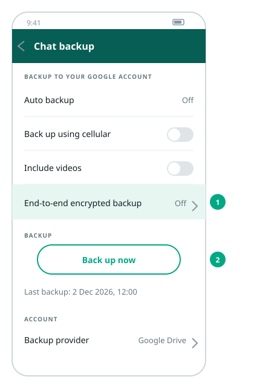
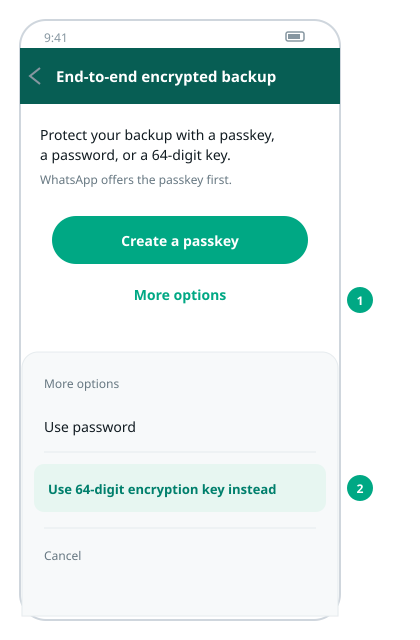
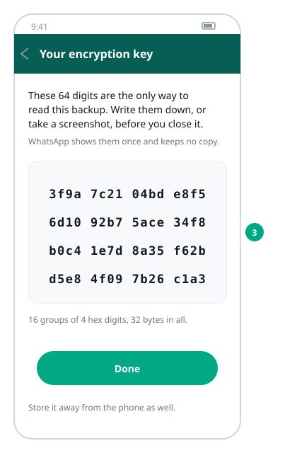

# Using wexport

What the person with the phone does, in order. Two phones are read: Android's encrypted `crypt15`
backup, and an iPhone's local Finder/iTunes backup. The release ships one archive per platform —
`wexport-<version>-linux-x86_64.tar.gz`, `wexport-<version>-windows-x86_64.zip` and
`wexport-<version>-macos-universal.tar.gz` — each holding the binary `wexport` (`wexport.exe` on
Windows) together with the licence files. Nothing has to be installed beside it.

| The backup you have | Can wexport open it? |
|---|---|
| Android, end-to-end encrypted with the **64-digit key** — `Databases/msgstore.db.crypt15` | **yes** |
| iPhone, **local backup** made by Finder/iTunes with "Encrypt local backup" off | **yes**, no key involved |
| iPhone, an extracted `ChatStorage.sqlite` (from a jailbroken phone or a container copy) | **yes** |
| Android, protected by a **password** | no: WhatsApp keeps the key on its servers |
| Android, protected by a **passkey** | no: same, the key never touches the file |
| Android with end-to-end encryption **off** — `msgstore.db.crypt14` | no: the file is not encrypted with a key you hold |
| Android on the old **crypt12** chain | no: that chain needs a password, not a key |
| iPhone, backup **encrypted with a password** | no: Apple's keybag is a different problem |
| iPhone, **iCloud** backup | no: it is not a folder on a computer |

Time: 20–40 minutes, most of it waiting for the backup and for the file copy. Needed: the phone, a USB
cable, a computer with enough free disk (the copied backup plus the archives can be tens of gigabytes),
and the archive for that computer from the
[releases](https://github.com/sequico/wexport/releases). Extract it and you have the binary: `wexport`
on Linux and macOS, `wexport.exe` on Windows. `tesseract` only if you hand wexport a screenshot of an
Android key instead of its digits.

---

## Android

## 1. Turn on end-to-end encrypted backup with the 64-digit key (once)

WhatsApp → **Settings → Chats → Chat backup → End-to-end encrypted backup**.



*The Chat backup screen. **1** — end-to-end encrypted backup. **2** — back up now.*

WhatsApp opens its protection screen and offers a **passkey** first:



*Turning it on. **1** — `More options`. **2** — the entry that gives you a key instead of a passkey.*

Tap **More options**, then **Use 64-digit encryption key instead**, then **Create**. Never choose
`Use password` and never accept the passkey: with either of those, WhatsApp keeps the key on its own
servers, and the file in your phone's folder is not something anyone — including you — can open
offline.

WhatsApp's own steps, in its own words:
[About end-to-end encrypted backup](https://faq.whatsapp.com/490592613091019?cms_platform=android) ·
[How to back up your chat history](https://faq.whatsapp.com/481135090640375?cms_platform=android).

## 2. Save the key now, because it is shown once



*The key screen: 16 groups of 4 hex digits. **3** — the digits, shown once.*

The key is 64 hexadecimal characters: 16 groups of 4, usually on four lines. It is 32 bytes, and it is
the only thing that opens the backup.

- **Write it down or screenshot it before you leave this screen.** WhatsApp shows it once, when the
  key is created, and cannot show it again.
- Keep the copy **outside the phone as well**: a screenshot in a photo library that syncs elsewhere, a
  password manager, a printed sheet, another computer. A screenshot that exists only on the phone is
  lost with the phone.
- If the key is lost, the backups become unreadable — the ones on the phone included. WhatsApp cannot
  reset it, send a copy, or restore the backup for you, and after five wrong entries the screen locks
  for a while
  ([WhatsApp](https://faq.whatsapp.com/639067727894647?cms_platform=android)).

**Already using a password or a passkey?** Turn end-to-end encryption off and on again, choose the
64-digit key this time, and then make a **new full backup** (step 3). Backups made before that stay
closed forever; the new full backup is the one wexport will open.

## 3. Make a full backup

Same screen (**Figure 1**), tap **Back up now**, and wait until WhatsApp says the backup finished.

With end-to-end encryption on, the backup file WhatsApp keeps in the phone's folder is
`msgstore.db.crypt15`, encrypted with that key. **Back up now** is what makes it complete and fresh;
the daily files beside it are only the changes made since.

A cloud copy is not what wexport reads. It reads the folder on the phone, which you copy in the next
step — so the archive can be built with the phone in airplane mode and no Google account involved.

## 4. Copy the folder to the computer

Connect the phone by USB, allow file transfer (MTP), and copy this folder **with its structure**:

```
Android/media/com.whatsapp/WhatsApp/          # WhatsApp Business: Android/media/com.whatsapp.w4b/WhatsApp Business/
├── Databases/     ← always: it holds msgstore.db.crypt15
├── Backups/       ← recommended: wa.db, which carries the contact names
└── Media/         ← the attachments themselves, usually most of the gigabytes
```

On macOS, use **OpenMTP** or **Android File Transfer**: `Android/media` is hidden in the Finder. On
Linux, the file manager over MTP works, or `adb` with the phone in developer mode:

```sh
adb pull /storage/emulated/0/Android/media/com.whatsapp/WhatsApp ./phone-copy
```

Put it anywhere, for example `~/whatsapp/phone-copy`. Three checks before going on:

1. `Databases/` contains a file named exactly `msgstore.db.crypt15`;
2. `Media/` is not empty and holds folders like `WhatsApp Images` and `WhatsApp Voice Notes`;
3. the size looks like your real archive — gigabytes, not megabytes.

If `Databases/` holds only `msgstore.db.crypt14` or `msgstore.db.crypt12`, end-to-end encryption with
the key is not on, or the backup was never redone after turning it on: go back to steps 1 and 3.

## 5. Run wexport

Point it at the folder you copied:

```sh
wexport ~/whatsapp/phone-copy
```

That prints the list and stops — no build, no disk use. Each chat has a code beside it; read the code
of the chat you want and build it with `-b CODE`, or build everything with `-b all`. The next section
has every flag and a line of examples.

The key reaches wexport as the 64 digits (`-k 0123…`), as a screenshot of them (`-k key.png`, needs
`tesseract`), or as the `encrypted_backup.key` file from a rooted phone (`-k encrypted_backup.key`).
With no `-k`, wexport looks beside the backup (and in the current folder) for `key.png` or another
image, `key.txt`, or `encrypted_backup.key`, and otherwise asks for the key on the terminal.

Archives land in `<folder>/output/`: one folder per chat, plus an `index.html` that lists them. When
the build ends, wexport opens that page in the desktop browser if there is one, and prints how many
messages and media files each archive holds.

---

## iPhone

An iPhone's WhatsApp data lives in the phone's local backup, which Finder (or iTunes on an older Mac
and on Windows) writes to a folder on the computer. wexport reads that folder directly. There is no
key, no password and no cloud step.

## 6. Make an unencrypted local backup

1. Connect the iPhone by cable and open **Finder**, or **iTunes** on Windows and older macOS.
2. Select the phone, open the **General** tab, and under **Backups** choose **Back up all of the data
   on your iPhone to this Mac** (or **Back Up Now**).
3. **Leave "Encrypt local backup" off.** An encrypted backup needs Apple's password keybag, and wexport
   says so and stops rather than producing an empty archive.
4. Wait for the backup to finish. It contains everything on the phone, so it can take a while and take
   a lot of disk.

You do not need WhatsApp's own 64-digit key for this: on an iPhone that key protects the **cloud**
copy, not the local one.

## 7. Run wexport on the backup folder

Point it at the phone's folder inside the backup. On a Mac it is:

```sh
~/Library/Application Support/MobileSync/Backup/<device-id>
```

On Windows it is `%APPDATA%\Apple Computer\MobileSync\Backup\<device-id>`; the `<device-id>` is a long
hex name, and `Info.plist` inside names the phone and the date. If you point at the parent folder
(`MobileSync/Backup`) and it holds more than one phone, wexport lists them and asks which one.

```sh
wexport ~/Library/Application\ Support/MobileSync/Backup/<device-id>
```

The rest is the same as Android: the chats are listed with a code each, `-b CODE` or `-b all` builds
them, and the archives land in the backup's `output/` folder.

If you already have the app's `ChatStorage.sqlite` on its own — an extracted container, from a
jailbroken phone or a forensic copy — point wexport at that folder instead.

---

## 8. Commands and flags

```
wexport [FOLDER] [flags]
```

`FOLDER` is the folder you copied — on Android the whole copy or `Databases/` itself; on iPhone the
device folder or a folder holding `ChatStorage.sqlite`. With no folder, wexport reads the current
directory. Inside it, the backup is found wherever the copy put it.

| Flag | Takes | Does |
|---|---|---|
| `-h` | — | print the help and exit |
| `-v` | — | print the version and exit |
| `-k KEY` | the 64 hex digits, a screenshot of them, or `encrypted_backup.key` | the Android key; without it, one is looked for beside the backup and otherwise asked on the terminal. An iPhone backup needs none, and giving one is an error |
| `-l [N] [ORDER]` | an optional count, an optional order | list and exit: `N` rows, ordered by `recent` (default), `size` or `name`; the two values come after the flag in either order |
| `-r` | — | reverse the listing order, so the oldest or the largest comes first |
| `-b CODES` | chat codes, comma-separated, or `all` | build those chats; the codes are the ones the list printed |
| `-o DIR` | a folder | where the archives go, instead of `<FOLDER>/output`; needs `-b` |
| `-t ZONE` | a zone name, `Europe/Rome` | render every time in that zone instead of the machine's; the name is written into each archive |
| `-j` | — | JSON lines on stdout: `found`, `chat_list`, `progress`, `warning`, `failure`, `finished`; errors stay on stderr |
| `-q` | — | no progress and no summary; a list or the JSON still prints |
| `-d` | — | diagnostics: the files found, the columns recognised, every media file placed or missing |
| `-n` | — | dry run: report what `-b` would build and write nothing; needs `-b` |
| `-c` | — | check the source and exit; with `-b`, check and then build |

The rules that decide most mistakes:

- **A code belongs to the list, not to the chat.** Codes are `1..N` in the default order, most recent
  first, and they do not move when `-l` orders or cuts the list. A different backup numbers its chats
  anew.
- **Listing is what happens when there is no `-b`**: `wexport FOLDER` alone is the list.
- **One flag per word**: `-l 10 size`, never `-ls`, and there are no long flags.
- **`-b` needs a code or `all`.** `-l` and `-b` together, `-o` without `-b`, `-n` without `-b`, `-r`
  without a listing, `-q` with `-d`, and `-c` with `-l` are all errors, each with a message that says
  so.
- **`-j` and `-q` compose** — the JSON is a result, not chatter. **`-j` and `-d` compose too**: the
  diagnostics become events of the same stream.

| Command | What it does |
|---|---|
| `wexport ~/whatsapp/phone-copy` | every chat, newest first |
| `wexport ~/whatsapp/phone-copy -l 10` | the ten most recent |
| `wexport ~/whatsapp/phone-copy -l size` | all of them, heaviest first |
| `wexport ~/whatsapp/phone-copy -l 5 recent -r` | the five oldest |
| `wexport ~/whatsapp/phone-copy -b 2` | build the chat with code 2 |
| `wexport ~/whatsapp/phone-copy -b 3,42` | build two chats |
| `wexport ~/whatsapp/phone-copy -b all -o /media/backup` | build everything, somewhere else |
| `wexport ~/whatsapp/phone-copy -b 2 -t Europe/Rome` | build one chat with Rome's clock, whatever this machine's zone is |
| `wexport ~/whatsapp/phone-copy -k key.png -b all` | the key from a screenshot, everything |
| `wexport ~/Library/.../Backup/<id> -l` | list an iPhone's chats |
| `wexport ~/Library/.../Backup/<id> -c` | check the iPhone backup before building |
| `wexport ~/whatsapp/phone-copy -b all -n` | say what a full build would write, and write nothing |
| `wexport ~/whatsapp/phone-copy -b all -j` | the same build, with JSON lines for a script |

The exit code is what a script reads:

| Code | Meaning |
|---|---|
| `0` | success |
| `1` | unreadable input, or a question that could not be asked without a terminal |
| `2` | unusable key: not a key, or the key does not open this backup |
| `3` | wrong backup type: a `crypt14`, password-based or passkey-based backup, or an encrypted iPhone backup |
| `4` | build incomplete: some media files could not be processed, the archive is usable |
| `5` | a missing external tool: `tesseract`, for a key given as a screenshot |

## 9. What can go wrong

| Message | Meaning | What to do |
|---|---|---|
| `only crypt14 backups in …` | end-to-end encryption was off when the backup was made | turn it on with the 64-digit key (step 1), back up now, copy again |
| `only crypt12 backups in …` | the old chain, which needs a password and has no end-to-end key | turn on the 64-digit key, back up now, copy again |
| `was made with a password` / `with a passkey` | the key is on WhatsApp's servers, not in the file | re-enable with the 64-digit key and make a new full backup; the old files stay closed |
| `the key does not open this backup` | wrong key, or the backup predates the current key | use the key from the screenshot; if the key was regenerated, build from a backup made after that |
| `is an iPhone backup encrypted with a password` | "Encrypt local backup" was on | turn it off, make the backup again, run wexport on the new folder |
| `no ChatStorage.sqlite in the backup` | WhatsApp's data is not in this phone's backup | open WhatsApp, make the backup again, and check the folder is the whole backup |
| `this folder holds more than one phone backup` | the path is the parent of several device folders | point wexport at one of the folders it lists |
| `tesseract not found` | the key was handed over as a screenshot and the reader is missing | install `tesseract`, or pass the 64 digits with `-k` |
| `media missing` in the build summary | that file is not in the copied `Media/` — deleted on the phone, or never downloaded | nothing; the archive shows a placeholder, and the phone's own preview when it kept one |
| contact names show as numbers | Android: `Backups/wa.db` was not copied; iPhone: the contact has no name in the database | copy `Backups/` and rebuild; on iPhone the number is what the phone shows too |

## 10. Afterwards

Each chat folder opens by double-clicking its `index.html`: no server, no wexport, no network.
Everything it needs is inside it — messages, images, video, voice notes with their waveform. Sharing
one chat means zipping that one folder, which is why a folder with video can be large.

Every message shows its full date and time with the UTC offset — `2026-11-17 14:32:05 +01:00` — with a
day separator above it, so the archive still says exactly when something was said in ten years. Those
strings are written at build time and never recomputed by the browser. The zone is the one of the
machine that runs the build, or the one `-t ZONE` names; either way the archive records which it was,
so a rebuild stays comparable.

Keep the key and the chat folders together but separately stored: the folders need no key at all to be
read, and the key without the backup opens nothing. An iPhone build needs no key at any point.

---

WhatsApp pages this flow is taken from, all of them current at the time of writing:

- [About end-to-end encrypted backup](https://faq.whatsapp.com/490592613091019?cms_platform=android) —
  the three protections, and that WhatsApp cannot recover any of them.
- [How to back up your chat history](https://faq.whatsapp.com/481135090640375?cms_platform=android) —
  the menu path and `Back up now`.
- [Can't remember password for encrypted backup](https://faq.whatsapp.com/639067727894647?cms_platform=android) —
  the five attempts, and what "turn it off and on again" costs.

The figures on this page are drawn from those steps, not taken from WhatsApp: the wording of the
buttons is WhatsApp's, the layout is ours.

---

wexport is written and maintained by [Sequi Company](https://sequi.company) — `info@sequi.company`.
